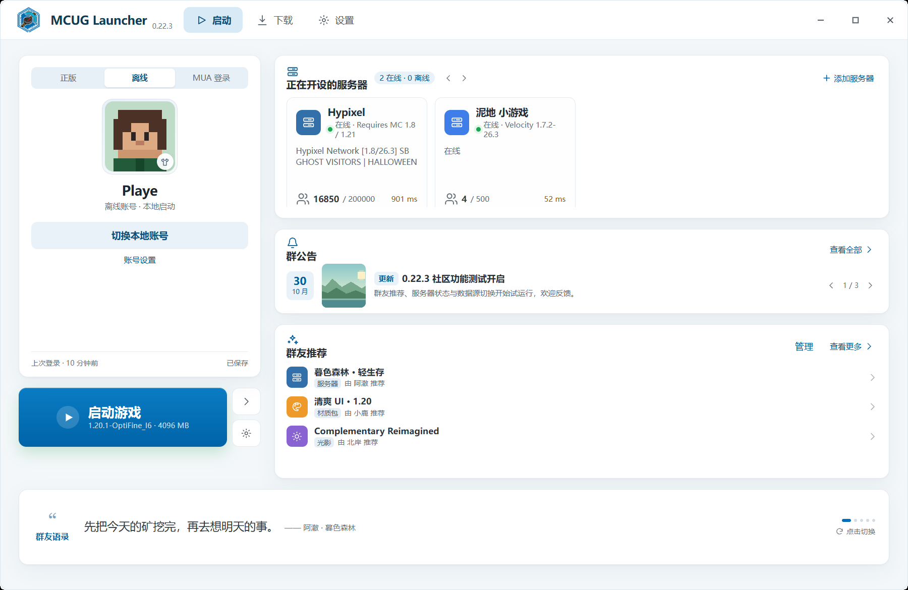

# MCUG Launcher 0.22.3

Windows 上的 Minecraft Java 版启动器。当前 0.22.3-codex 是 WebView2 迁移开发分支，已接回下载任务、加载器安装、整合包导入、运行游戏、收藏与存档备份等入口，仍有部分旧功能待恢复。具体范围见 [修复状态](docs/REPORT_FIX_STATUS.md)。

当前版本为 **0.22.3**。



## 0.22.3 更新重点

- **新的蓝白界面**：主页去掉左侧栏，顶部「启动 / 下载 / 设置」直接切换页面；设置页和下载页保留各自的页内导航。
- **版本选择面板**：点击「启动游戏」右侧的 `>`，游戏目录从右侧展开，可在「原版游戏 / FABRIC 版本」中直接选版本启动。
- **版本内容管理**：横向分类标签，模组表格支持更新、禁止更新、禁用、启动、删除；可切换当前实例。
- **模组下载链路**：「下载 → 模组」列表进入模组详情，支持安装到实例，或下载到自定义目录。
- **社区功能**：群公告、群友推荐、群友语录、正在开设的服务器。
- **设置**：匿名模式、社区身份密钥、管理员认证、四类独立数据源、写入接口。
- **公告配图**：管理员发布公告时可选择本地图片，随公告一起保存；配置写入接口后会一并提交。
- **账号**：离线账号直接进入游戏；皮肤 / 披风入口位于账号头像。

## 功能说明

### 主页

- 账号卡：正版 / 离线 / MUA 三个入口。正版走系统浏览器 OAuth，MUA 走账号密码 + authlib-injector，离线账号直接本地启动。
- 头像角标与悬停提示进入「皮肤与披风」面板。
- 「启动游戏」读取最后一个实例；右侧两个方形按钮分别是「选择实例」和「版本内容管理」。
- 右侧依次为：正在开设的服务器、群公告、群友推荐、群友语录。
- 服务器状态由启动器直接通过 MC Server List Ping 获取，8 秒超时；失败保留上一次结果。
- 公告 / 推荐 / 语录都支持加载、空、错误状态。

### 下载

- 页内导航：群友推荐、原版游戏、模组、整合包、资源包、光影、数据包。
- 群友推荐按服务器 / 材质包 / 光影切换。
- 官方分类已接入在线目录：原版游戏读取 Mojang 版本清单；模组 / 整合包 / 资源包 / 光影 / 数据包从 Modrinth 搜索，并可按当前实例版本筛选。
- 模组列表 → 模组详情：安装到实例，或下载到自定义目录。整合包仅下载 `.mrpack` 文件，不自动导入。
- 搜索结果需要联网；内容说明来自 Modrinth，暂不提供中文翻译。

### 版本

- 主页右侧「选择实例」打开实例面板，可直接启动任一组版本。
- 「版本内容管理」展示模组表格；实例切换在页面右上角。
- 「版本设置」展示概览、个性化、快捷方式、启动概览、高级管理；不包含 Mod 管理（已移到内容管理页）。

### 设置

- 启动设置：游戏根目录、Java 路径、最大内存、游戏窗口宽高；可保存、选择路径。
- Java 管理：按本机 PATH、JAVA_HOME、常见安装目录查找 `java.exe`，列出路径后可选用；不会自动修改游戏版本。
- 下载与网络：查看四类数据源、跳转数据源设置、打开游戏目录。
- 界面与背景：固定蓝白主题；恢复默认窗口尺寸。
- 社区：更多选项、管理员、数据源。
- 服务器收藏：查看收藏服务器、重新 ping、管理或添加。
- 存档保护：一键打包 `saves` 到本地备份目录，或打开存档文件夹。
- 下载任务：说明当前版本不保留后台任务，并提供模组下载入口。
- 任务与恢复：恢复窗口、重新加载界面、打开配置目录。
- 运行日志：读取最近 400 行日志，打开日志目录。
- 诊断与反馈：读取 .NET / WebView2 / 系统 / 路径信息并复制。
- 关于与许可：版本、社区数据仓库、管理员文档入口。
- 社区 → 更多选项：匿名模式、社区身份密钥。
- 社区 → 管理员：未设置时首次输入即设置本机管理员密钥；之后必须输入同一密钥才能发布公告。
- 社区 → 数据源：四类 URL 独立配置、逐项测试、保存、恢复默认、可选写入接口。

## 数据源

四类数据分别读取独立 JSON：

| 类型 | 示例文件 | 主要字段 |
| --- | --- | --- |
| 公告 | `community/announcements.json` | `id, title, body, tag, author, publishedAt, expiresAt, imageUrl?` |
| 服务器 | `community/servers.json` | `id, name, address, description, version, mode, tags, icon` |
| 推荐 | `community/recommendations.json` | `id, type(server/material/shader), name, author, description, tags, version, size, url` |
| 语录 | `community/quotes.json` | `id, type(text/image), text, author, source, imageUrl?, created_at` |

默认地址集中在 `Models/AppConfig.cs` 的 `DataSourceConfig`，当前指向 `waibibabu1239/MCUGL-storage`。首次使用的旧配置不会自动覆盖；如仍指向示例仓库，请在「设置 → 数据源」点「恢复默认」再保存。

- 读取超时 8 秒；单个地址失败不会阻塞其他区块。
- 管理员写入接口可选；未配置时公告只保存在本机，并显示「待发布」。
- 公告配图以 data URL 保存/提交；如果写入接口有对象存储，建议在服务端转存并替换为图片 URL。
- 管理员认证、删除边界与 GitHub 托管步骤见 [docs/admin-and-community.md](docs/admin-and-community.md)。

本轮继续接回实例克隆、整合包 ZIP 导出、卸载路径预览和内容更新预览；结构与格式检查结论见 [代码风格复查](docs/CODE_STYLE_REVIEW.md)。

## 技术架构

```
WPF .NET 8 宿主 (MainWindow / WebView2)
        │  虚拟域名 app.local
        ▼
内嵌 HTML/CSS/JS (src/MCUGLauncher/Ui)
        │  window.chrome.webview 消息桥
        ▼
C# 服务：版本扫描 / 启动 / 服务器 ping / Modrinth / 社区 JSON / 配置
```

选择 WebView2 的原因：0.22.3 的设计稿是一套完整的前端视觉系统，直接复用 HTML/CSS 能保证 1:1 还原，同时把 C# 服务与 UI 分离，后续换界面不需要动启动核心。

开发说明与检查范围见 [WebView2 UI 开发说明](docs/WEBVIEW_UI.md)，本分支整理记录见 [0.22.3-codex](docs/REVIEW_0.22.3-codex.md)。

### 目录

```
src/MCUGLauncher/            WPF 宿主、服务、桥接
  Ui/                        已批准的界面资源
  UseCases/                  消息分发与按职责划分的业务流程
  Services/                  配置、版本、ping、社区、模组
  Models/AppConfig.cs        集中配置模型
src/MCUGLauncher.Core/       启动核心（沿用 0.22.2）
community/                   数据源示例 JSON
docs/images/                 README 截图
dist/full/                   完整版发布产物
dist/lite/                   轻量版发布产物
```

## 运行要求

- Windows 10 / 11 x64。
- **WebView2 Runtime**（Windows 11 通常已内置；Windows 10 如缺失需安装 Evergreen Runtime）。
- 完整版：无需安装 .NET。
- 轻量版：需要 **.NET 8 Desktop Runtime x64**。

| 版本 | 文件 |
| --- | --- |
| 完整版 | `dist/full/MCUGLauncher-0.22.3-Windows-x64.exe` |
| 轻量版 | `dist/lite/MCUGLauncher-0.22.3-Windows-x64-Lite.exe` |

## 构建

```powershell
dotnet build MCUGLauncher.sln -c Release
```

## 发布

完整版（自包含单文件）：

```powershell
dotnet publish src\MCUGLauncher\MCUGLauncher.csproj -c Release -r win-x64 `
  --self-contained true -o dist\full
```

轻量版（依赖 .NET 8 Desktop Runtime）：

```powershell
dotnet publish src\MCUGLauncher\MCUGLauncher.csproj -c Release -r win-x64 `
  --self-contained false -p:EnableCompressionInSingleFile=false -o dist\lite
```

> 轻量版不能启用单文件压缩，否则 .NET SDK 会报 `NETSDK1176`。

## 本地数据

- 配置：`%LOCALAPPDATA%\MCUGLauncher\config.json`
- 界面缓存：`%LOCALAPPDATA%\MCUGLauncher\ui-0.22.3\`
- WebView2 数据：`%LOCALAPPDATA%\MCUGLauncher\WebView2\`
- 本地公告：`%LOCALAPPDATA%\MCUGLauncher\announcements.local.json`
- 本地推荐：`%LOCALAPPDATA%\MCUGLauncher\recommendations.local.json`
- 账号令牌：`%LOCALAPPDATA%\MCUGLauncher\auth\`

首次启动会尝试从 0.22.2 的 `%LOCALAPPDATA%\BlockLaunch\settings.json` 导入游戏目录、玩家名、Java、内存、窗口尺寸和收藏服务器。

## 已知限制

- 微软登录使用系统浏览器完成 OAuth；MUA 使用账号密码并注入 authlib。两项都需要真实账号和网络，当前环境未做真实账号联调；失败时会回到离线账号。
- 皮肤 / 披风面板目前只有入口与预览，选择操作尚未接入皮肤站上传与外层渲染。
- 资源包 / 光影 / 存档 / 截图 / 蓝图标签显示 0，尚未实现目录扫描。
- 版本设置中的「修改版本名 / 补全文件」等按钮是界面占位，启动、打开文件夹、切换实例、版本内容管理已可用。
- 群友推荐只有推荐列表；下载跳转依赖 JSON 中的 `url`。
- 0.22.3 不含自动更新。

管理员认证、公告发布和 GitHub 数据托管见 [docs/admin-and-community.md](docs/admin-and-community.md)。

## 变更记录

见 [CHANGELOG.md](CHANGELOG.md) 与 [docs/release-notes-0.22.3.md](docs/release-notes-0.22.3.md)。

## 许可

本项目未附带新的开源许可证；发布前请沿用原仓库的许可策略。


