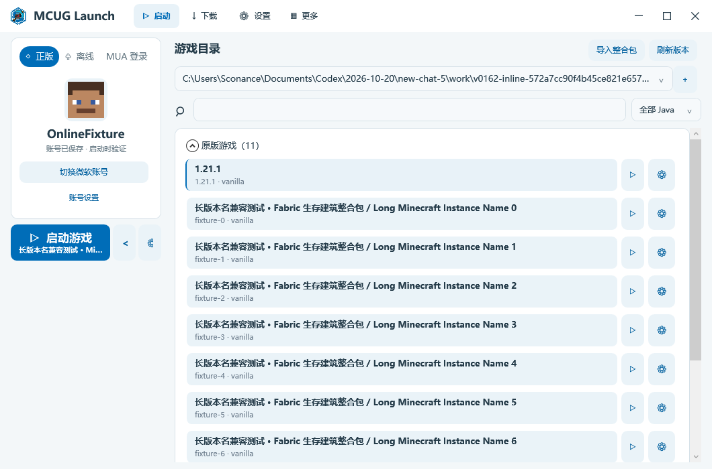
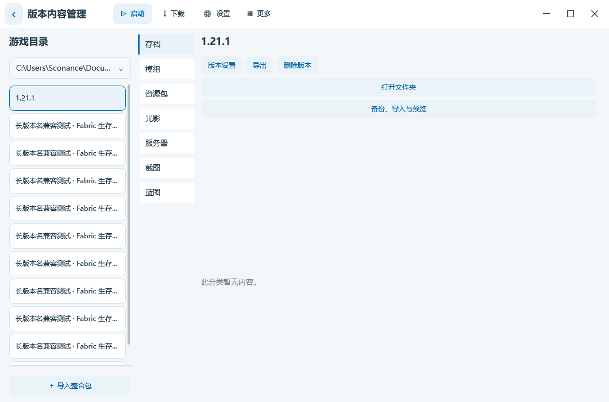
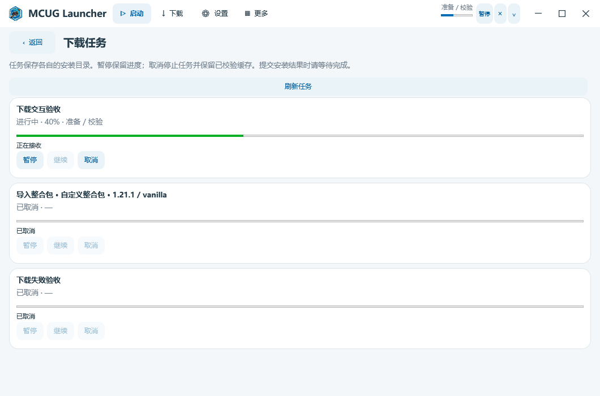
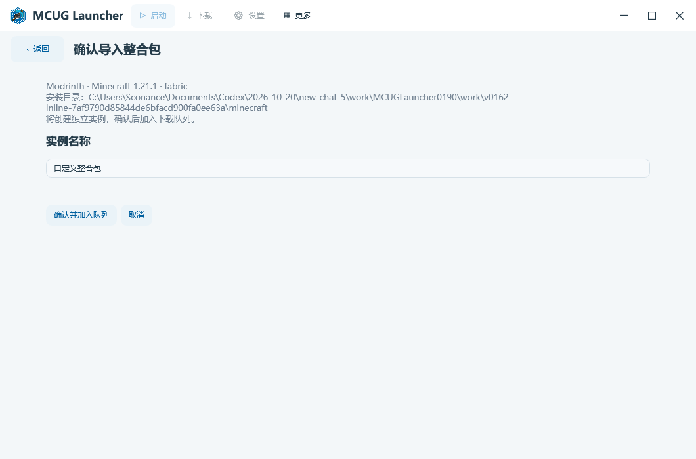
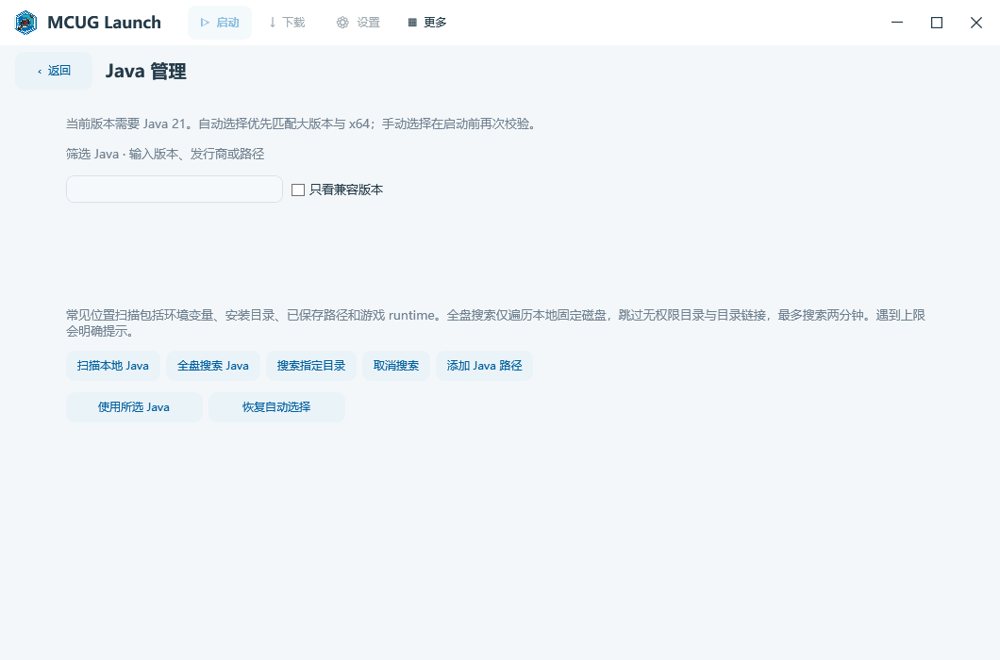
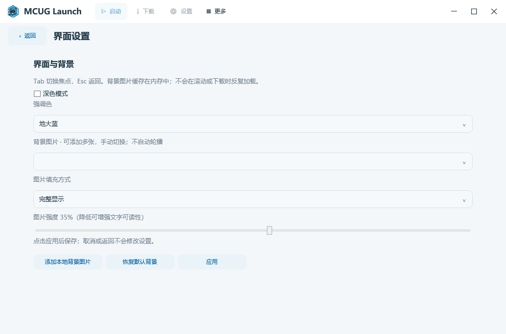

<p align="center"></p>
<h1 align="center">MCUG Launcher</h1>
<p align="center">面向 Windows 的 Minecraft Java 版启动器</p>
<p align="center"><a href="https://github.com/Sconance/MCUGLauncher/releases/latest">下载最新版</a> · <a href="docs/USAGE.md">使用指南</a> · <a href="https://github.com/Sconance/MCUGLauncher/issues">反馈问题</a> · <a href="CHANGELOG.md">更新记录</a></p>

MCUG Launcher 提供游戏启动、分类下载、账号登录和实例内容管理，采用 MCUG 蓝白主题，支持浅深配色与本地背景。升级保留现有账号、配置和实例数据。

## 界面预览





<details><summary>下载任务与整合包确认</summary>




</details>

<details><summary>Java 管理与个性化</summary>




</details>

截图来自隔离测试环境，实例与账号信息仅用于演示。

## 功能


| 方向       | 已有能力                                                |
| ---------- | ------------------------------------------------------- |
| 账号与启动 | 微软正版、离线角色、MUA 认证，头像与会话刷新            |
| 游戏下载   | 原版分类、模组加载器安装相关流程                        |
| 资源中心   | Modrinth 模组、整合包、资源包、光影、数据包，收藏与标签 |
| 实例管理   | 多目录、隔离、分类、搜索、直接启动、启动参数与内容管理  |
| 整合包     | Modrinth、MultiMC / Prism 导入，清单预检与可选内容导出  |
| Java       | 常见位置扫描、指定目录与全盘搜索、手动指定、版本匹配    |
| 下载任务   | 紧凑进度与速度、暂停继续、失败重试、任务恢复            |
| 辅助工具   | 存档备份、截图预览、日志、崩溃线索与诊断导出            |

当前资源平台以 Modrinth 为主，CurseForge 在线服务未接入。蓝图入口浏览实例的 schematics 目录。社区、在线公告及新闻尚未实现。

## 下载与运行

在 [Releases](https://github.com/Sconance/MCUGLauncher/releases/latest) 下载对应 EXE，直接运行。完整版文件名保持 Windows-x64.exe，内置 .NET 运行库；精简版文件名以 Windows-x64-Lite.exe 结尾，需要电脑安装 .NET 8 Desktop Runtime x64。游戏需匹配版本的 Java；内嵌微软授权页面需要 WebView2 Runtime。

升级前关闭启动器，再替换 EXE，保留原有配置和游戏目录。删除版本前检查确认框，重要存档先备份。

## 源码与构建

当前版本为 **0.22.2**，最终产品名确定为 **MCUG Launcher**。使用 Windows x64 与 .NET 8 SDK：

```powershell
git clone https://github.com/Sconance/MCUGLauncher.git
cd MCUGLauncher
dotnet build src/MCUGLauncher/MCUGLauncher.csproj -c Release
dotnet publish src/MCUGLauncher/MCUGLauncher.csproj -c Release -o artifacts/publish
```

详见 [构建与目录说明](docs/BUILD.md)。历史版本源码仍保留在各 Release 的手动 Source.zip 附件中；旧标签未移动，旧版自动生成的 Source code 归档可能仅含原仓库文件。

版本号只有一个来源（`Directory.Build.props` 的 `McugVersion`），发版、标签与检查规则见 [版本号控制](docs/VERSIONING.md)。0.22.0 已合并到 `main`；0.22.1 在同名分支实现并发布多实例运行、本地优先启动与设置页面优化：`Components/` 已按九个功能域重组，`MainWindow` 拆成窗口 shell、九个独立 XAML 页面与功能模块；合并步骤、验证结果与风险见 [合并到主分支前的说明](docs/MERGE_TO_MAIN.md)，发布说明与文件哈希见 [发布说明](docs/releases/README.md)，后续计划见 [重构路线图](TODO.md)，历史材料在 [历史归档](docs/archive/branch_refactor/README.md)，类型说明在 [类文档目录](docs/classes/README.md)。

```text
src/       主程序与核心逻辑（2 个项目）
test/      功能、界面与集成检查（24 个项目）
tools/     隔离界面预览（4 个）和源码格式工具
scripts/   构建与检查脚本
docs/      使用、构建、类文档（classes/）、历史归档（archive/）与截图
```

## 反馈与贡献

请在 [Issues](https://github.com/Sconance/MCUGLauncher/issues) 提供软件版本、系统版本、复现步骤和脱敏日志。不要上传密码、Token、账号缓存或私人存档。参阅 [贡献说明](CONTRIBUTING.md)。

## 近期更新

### 0.22.2（开发分支，不发布 Release）

- 资源版本支持下拉选择和输入搜索；资源包与光影包隐藏加载器条件，修复搜索卡片收藏点击。
- 详情右侧以互斥模式选择自定义下载或安装到实例，任务固定目标目录与兼容版本。
- 实例副标题只展示游戏/加载器版本；分类标题整行可展开收起。
- 下载任务可删除已结束记录或清空历史，保留下载文件。
- 模组管理合并到版本内容管理，列表撑满剩余空间，旧入口跳转到统一页面。
- 启动按钮内显示简短状态和进度动画；延续独立视图与明确依赖结构。


### [0.22.1](https://github.com/Sconance/MCUGLauncher/releases/tag/v0.22.1)

- “更多”工具并入设置侧栏，按启动环境、个性化、游戏工具、任务诊断和关于分类；功能与扩展接口保留。

- 不同独立实例可同时运行，分别查看本次日志和请求关闭；同一实例支持更换离线 ID 后多开，相同身份仍防重复启动。
- 启动只等待本地恢复，在线版本在进入下载页后按需加载；新增请求合并、超时和重试状态。
- 运行列表可点击并独立关闭游戏，关闭前二次确认；下载进度统一在右上角显示。
- 设置工具拆成独立页面，通过明确依赖与操作回调组装，不再依赖标签位置、控件树或弹窗解包。
- 继续沿用功能域、组合层和类型文档规范，账号协议与配置格式不变；[完整发布说明](docs/releases/0.22.1.md)。


### [0.22.0](https://github.com/Sconance/MCUGLauncher/releases/tag/v0.22.0)

准备合并到 `main` 的结构与文档版本。`refactor` 分支已废弃，相关记录归档到 [docs/archive/branch_refactor/](docs/archive/branch_refactor/README.md)。

- `Components/` 按 Accounts、Shell、Downloads、Resources、Instances、Launch、Experience、Bookmarks、Support 九个功能域重组；10 个控制器按职责改名（`Sketch`→`InstanceContent`、`Content`→`ResourceBrowser`、`Pack`→`Modpack`、`Stability`→`TaskRecovery` 等）。
- 补齐 `src/MCUGLauncher` 全部 142 个顶层类型的类文档，归档到 [docs/classes/](docs/classes/README.md)，新增 `scripts/check-class-docs.py` 与 CI 检查。
- 文档体系整理：refactor 时代的对照、迁移与合并记录移入 [历史归档](docs/archive/branch_refactor/README.md)；新增 [合并到主分支前的说明](docs/MERGE_TO_MAIN.md)。
- 记录前后端分界评估结论与后续项，写入 [重构路线图](TODO.md)。

### [0.21.0]

- warning 由于test的更新，refactor分支废弃，本版本不发布，仅用于声明连续性
`test` 主干与 `refactor` 全量整合后的版本。结构以 `test` 的原生窗口 shell、九个独立 XAML 页面与组合根为准；`refactor` 的文档规则、版本控制与 0.20.1 / 0.20.2 功能内容全部并入，`refactor` 不再单独递增版本号。

- 合并 `refactor`（`db0ab6a`）：86 个 `MainWindow` partial 与 51 篇逐类文档按结构退役，历史内容保留在 `refactor` 分支，迁移去向见 [refactor 分支整合记录](docs/archive/branch_refactor/REFACTOR_INTEGRATION.md)。
- 版本号改为单一来源 `Directory.Build.props` 的 `McugVersion`，运行期统一读取 `ProductInfo.Version`。
- 修复诊断信息 `0.20.0`、导航区 `0.15.2`、关于区 `0.20.2` 与两处 User-Agent 的写死版本。
- 新增 `scripts/check-version.py` 与 CI 版本校验，发版标签、CHANGELOG、README 与程序集元数据必须一致。
- 新增 [版本号控制](docs/VERSIONING.md)、[refactor 分支整合记录](docs/archive/branch_refactor/REFACTOR_INTEGRATION.md)、[重构路线图](TODO.md) 与 [develop 与 refactor 功能对照](docs/archive/branch_refactor/COMPARE_DEVELOP_REFACTOR.md)，把整合与拆分检查要点沉淀为长期规则。
- 保留 `test` 的 Esc 关闭页内选择器、嵌套改名后实例列表与首页名称同步修复

### [0.20.2](https://github.com/Sconance/MCUGLauncher/releases/tag/v0.20.2)

- 按蓝白效果图完善多列资源卡片、心形收藏和详情布局。
- 增加仅显示收藏、资源排序以及卡片/列表切换。
- 为顶部、下载、设置、更多、主页、资源详情、版本设置和实例分类提供统一菜单注册接口。
- 开发者可参考 [菜单扩展说明](docs/MENU_EXTENSIONS.md) 增加栏目和图片图标。

### [0.20.1](https://github.com/Sconance/MCUGLauncher/releases/tag/v0.20.1)

- 下载分类增加统一图标区域，并为替换图片保留配置接口；资源列表改为随窗口宽度变化的多列卡片。
- 资源列表和页内详情分离，提供介绍、版本和依赖切换，展示实际项目截图及正文预览。
- 加载器按横向配置行排列，可选择游戏与加载器版本；保留品牌配色和透明背景 MCUG Logo。

### [0.20.0](https://github.com/Sconance/MCUGLauncher/releases/tag/v0.20.0)

源码可读性整理：统一格式，拆分账号面板与下载任务职责，加入开发导览和格式检查。

### [0.19.2](https://github.com/Sconance/MCUGLauncher/releases/tag/v0.19.2)

- 拖入文件显示导入提示；整合包先确认名称和目标目录，其他资源导入管理页当前实例。
- 顶栏下载进度、任务栏进度与内嵌下载列表，支持暂停、继续、取消和失败重试。
- 下载期间保留账号切换和版本浏览；认证操作先提示暂停下载，安装与启动仍保持互斥。

### [0.19.1](https://github.com/Sconance/MCUGLauncher/releases/tag/v0.19.1)

- 启动页移除 Java 筛选与搜索图标，新增搜索占位提示。
- 大启动按钮搭配纵向展开、设置按钮。
- 版本内容管理增加目录切换，标题整合到顶栏，列表和滚动条更紧凑。
- 强化导入区域分隔，修复内嵌页面切换深色主题时的背景。

### [0.19.0](https://github.com/Sconance/MCUGLauncher/releases/tag/v0.19.0)

- 最终名称确定为 MCUG Launcher，统一界面、程序元数据、仓库与文档。
- 源码项目目录和构建入口同步更名，保留现有账号、配置与实例兼容。


[完整更新记录](CHANGELOG.md) · [全部历史版本](https://github.com/Sconance/MCUGLauncher/releases)

MCUG Launcher 为独立项目，非 Mojang 或 Microsoft 官方产品。第三方组件见 [依赖清单](docs/DEPENDENCIES.md) 与程序内声明。项目整体许可证尚未指定，不代表自动授予任意使用或再分发许可。

开发者可从 [开发导览](docs/DEVELOPMENT.md) 查看功能入口、模块边界与编码约定。
