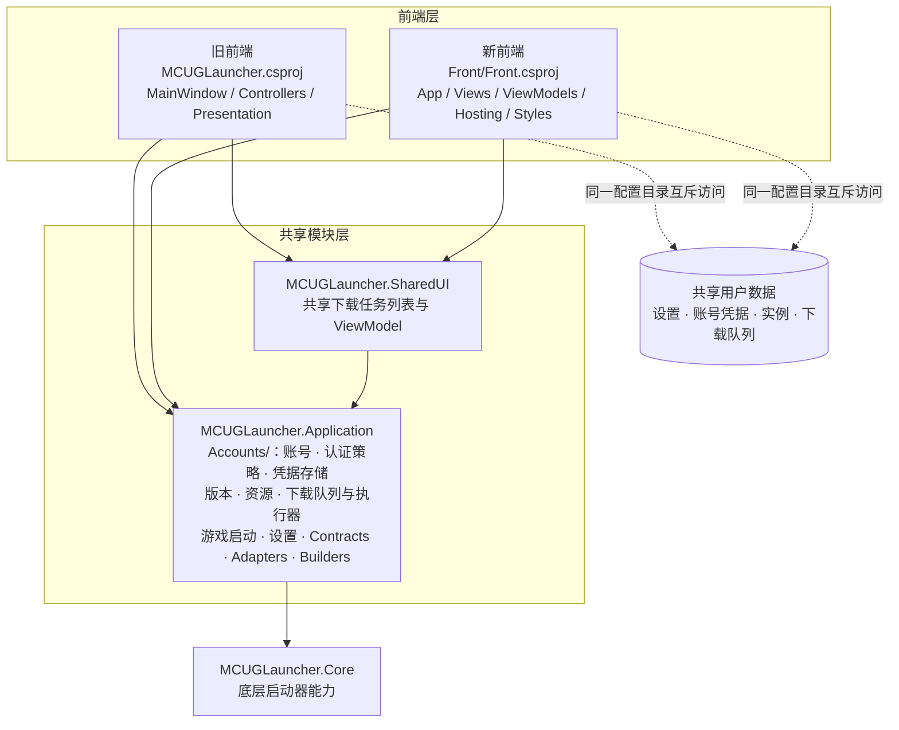

# 当前项目架构图

以下 Mermaid 图基于当前项目引用关系，更新于 2026-10-29。实线表示项目引用，虚线表示运行时访问。

## 边界说明

- 两个前端互不引用，均通过共享项目调用业务；共用下载界面属于 SharedUI，不属于任一前端。
- Front 自带入口、主题及窗口资源，不再读取旧入口的 App.xaml。
- Application 链接编译 `src/MCUGLauncher/` 下的共享业务源码；该容器目录也包含 Front，不能整体当作旧前端删除。
- 图未展开旧控制器内部的窗口依赖；前端独立构建不代表 Front 已覆盖旧前端全部功能。
- 双向移除构建已通过；Windows 原生界面与完整业务运行验收仍需执行。

目录编译所有权、功能边界及验证结果见 [双前端独立项目](FRONTEND_PROJECTS.md)；账号认证边界见 [账号与认证模块](ACCOUNTS_MODULE.md)；设置边界见 [设置模块](SETTINGS_MODULE.md)；Front UI 复刻进度见 [Front UI 复刻进度](FRONT_UI_PARITY.md)；Front 调用范围见 [Front 运行与验收](FRONT_RUNTIME.md)。
